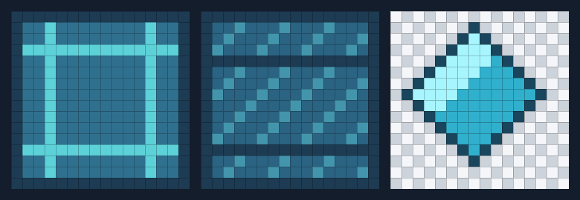

# Starblazer Craft

Minecraft **1.20.1 / Forge 47.x** 用の、機能を一切追加しない空の MOD です。

Forge 標準の `lowcodefml` ローダーを使用し、MOD の認識に必要なメタデータのみを収録します。
Java クラス、アイテム、ブロック、レシピなどはありません。

## 導入

1. Minecraft 1.20.1 と Forge 47.x をインストールします（実行には Java 17 が必要です）。
2. [Releases](https://github.com/Python121212/Starblazer-Craft/releases) から JAR を取得します。
3. 対象プロファイルの `mods` フォルダーに JAR を配置します。

クライアント・サーバー両対応のメタデータです。Fabric 用ではありません。

## ビルド

Python 3.11 以降で実行できます。外部ライブラリ、JDK、ForgeGradle は不要です。

```sh
python3 scripts/build.py
```

出力: `build/libs/starblazer-craft-1.20.1-0.0.1.jar`

ソースは main、配布用 JAR は GitHub Releases に配置します。
JAR はバージョン管理に含めません。

## 動作確認について

JAR の構造とメタデータは検査していますが、Minecraft / Forge の実起動テストは未実施です。

## テクスチャ・JSON の見本

[日本語ガイド](docs/TEXTURES.md) に、16×16 PNG の形とモデル・blockstates JSON の対応をまとめています。
素材は `docs/examples/` にあり、現段階では JAR に入りません。ゲーム内の機能は追加していません。



## GitHub 自動テスト・3D 素材ラボ

push / PR ごとにテスト・ビルド・素材検査を実行し、JAR とブラウザー用ビューアーを Artifact に保存します。
サイトは自動更新しません。更新の依頼があるときだけ、main の手動実行で「サイトを更新する」を選択して公開します。
普段の説明・仕様・進捗は主に Markdown を更新します。

- [素材ラボ（テクスチャと回転可能な 3D 見本）](https://python121212.github.io/Starblazer-Craft/)
- [操作方法・素材の追加・自動検査の範囲](docs/AUTOMATION.md)

ゲーム実行テストではありません。現在は物理計算の実装・性能検査もまだ含まれません。
