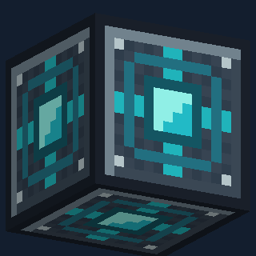

# コアブロック（0.3.1）

レンチで範囲選択を始めるための、実際に設置できる通常ブロックです。

- ID：`starblazercraft:core`
- 名前：日本語「コア」、英語「Core」
- 入手：クリエイティブの **Starblazer Craft** タブ、または `/give @s starblazercraft:core`
- 金属の設置音、硬さ4・爆破耐性8、明るさ7
- 鉄以上のツルハシで回収可能。素手・不適切な道具ではアイテムを落としません。
- クラフトレシピ・専用画面・内部インベントリはまだありません。

## 使用方法

1. 通常の建築可能な場所にコアを設置します。
2. レンチでコアを右クリックし、選択を開始します。
3. コアを含む直方体の端点を2点、右クリックで指定します。
4. 範囲外のブロックは Shift＋左クリックで追加できます。

既存の `starblazercraft:assembly_cores` タグに登録しているため、テスト用データパックは不要です。
選択成功時には対象ブロックの設置音が鳴ります。コアの場合は金属音です。
コアが壊された場合、レンチの次の選択操作は既存のコア検証で拒否します。

**今回は選択の起点だけです。エンティティ化・船の移動は実装していません。**
選択データは引き続きレンチに保存し、コアに毎tickの処理やブロックエンティティは追加していません。

## 見た目

オリジナルの16×16テクスチャで、金属の外枠と青緑色の中心を持つ立方体です。
全6面で同じ画像を使用し、設置時・手持ち・インベントリで立体表示します。

上の画像はJSONから生成した見本で、ゲーム内スクリーンショットではありません。
[テクスチャ一覧](../テクスチャ一覧.md) に元画像と手持ち見本も掲載しています。
再生成：`python3 scripts/generate_core_texture.py` → `python3 scripts/generate_texture_index.py`

## 確認

モデル参照、コアタグ、道具タグ、ドロップ定義、翻訳、一覧PNGの同期を自動検査します。
ゲーム内での設置・回収・発光・レンチ連携・マルチ操作は未検証です。
月の解析的地表は通常ブロックではないため、そこには設置できません。
サイトの公開は行いません。
