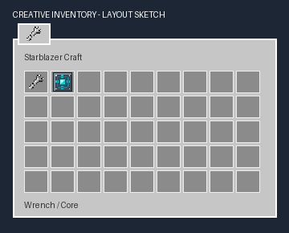

# クリエイティブ専用タブ（0.1.4）

- 名前：**Starblazer Craft**（日本語・英語の表示名を登録）
- タブ ID：`starblazercraft:main`
- アイコン：レンチ
- 内容：本 MOD のアイテム登録一覧を参照。現在はレンチとコアブロックの2種類。

クリエイティブモードのインベントリを開いて、レンチのアイコンのタブを選択します。
タブが多い環境では Forge のタブページ切り替えも確認してください。
レンチは従来の「道具と実用品」タブにも残しています。
サバイバルの通常インベントリに新しい枠を増やす機能ではありません。

`ITEMS` の DeferredRegister にアイテムを追加すると、専用タブの内容にも反映されます。
将来ブロックを追加するときは、対応する BlockItem を同じ登録一覧へ追加してください。
表示名は言語ファイルで管理し、専用タブの登録は共通側で行うため、クライアント専用クラスには依存しません。

## 配置イメージ

説明用の配置図で、ゲーム内スクリーンショットではありません。
バニラのUI背景・枠を使用するため、新しいゲーム用UIテクスチャは追加していません。
[テクスチャ一覧](../テクスチャ一覧.md) にも掲載しています。

## 確認

GitHub Actions で Forge コンパイル・既存テスト・画像一覧の同期検査を実施します。
実機でのタブ表示・レンチ取得、専用サーバー接続後の動作は別途確認が必要です。
サイトは更新しません。
