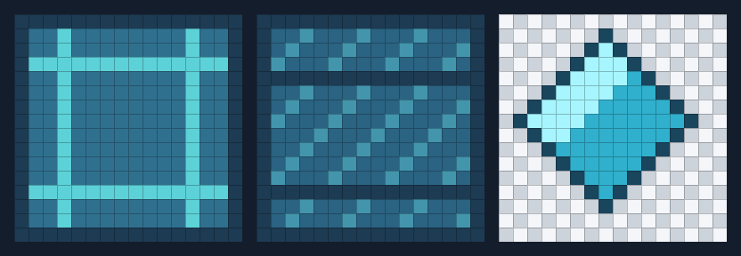

# テクスチャと JSON の見本（Forge 1.20.1）

現時点では**説明用の素材だけ**です。ブロックやアイテムの登録処理は追加しません。
`docs/examples/` は JAR の収録対象外で、既存の空 MOD の動作を変えません。

## 1. PNG の形を確認する



左から **ブロックの上面／側面・底面／アイテムのクリスタル**。
上の図は各素材を16倍に拡大した説明画像です。マス目は元画像の1ピクセル、右の市松模様は透明部分を示します。
**説明画像をそのままゲーム用テクスチャにしないでください。**

|素材（クリックで元 PNG）|サイズ|形・透明度|
|---|---|---|
|[example_block_top.png](examples/assets/starblazercraft/textures/block/example_block_top.png)|16×16 px|正方形・全面不透明。上面用|
|[example_block_side.png](examples/assets/starblazercraft/textures/block/example_block_side.png)|16×16 px|正方形・全面不透明。側面と底面で共有|
|[example_crystal.png](examples/assets/starblazercraft/textures/item/example_crystal.png)|16×16 px|ひし形の結晶・周囲は透明|

素材はこのリポジトリ用に生成したオリジナルです。
ドット絵の編集・拡大には「最近傍／ニアレストネイバー」を使い、輪郭のぼけを避けます。
PNG は色、JSON は立体の形や参照先を担当します。PNG の輪郭だけでブロックの当たり判定は変わりません。

## 2. ファイルの対応

以下のパスはすべて `docs/examples/assets/starblazercraft/` からの相対パスです。

```text
blockstates/example_block.json
  └─ models/block/example_block.json    ← ワールドに置いた立方体
       ├─ textures/block/example_block_top.png  ← 上面
       └─ textures/block/example_block_side.png ← 側面・底面
models/item/example_block.json          ← 手持ち・インベントリのブロック
  └─ models/block/example_block.json
models/item/example_crystal.json        ← 平面画像から描画するアイテム
  └─ textures/item/example_crystal.png
```

- [`blockstates/example_block.json`](examples/assets/starblazercraft/blockstates/example_block.json): 状態とモデルを結びます。`""` は状態プロパティを持たないブロックの例です。
- [`models/block/example_block.json`](examples/assets/starblazercraft/models/block/example_block.json): `minecraft:block/cube_bottom_top` を継承。形は標準の立方体（16×16×16 モデル単位 = 1ブロック）で、`top`・`bottom`・`side` に画像を割り当てます。
- [`models/item/example_block.json`](examples/assets/starblazercraft/models/item/example_block.json): ブロックモデルを継承し、手持ちなどの表示にも利用します。
- [`models/item/example_crystal.json`](examples/assets/starblazercraft/models/item/example_crystal.json): `minecraft:item/generated` と `layer0` でアイテム画像を指定。独自の立体モデルではありません。

### JSON の参照名の読み方

```json
"top": "starblazercraft:block/example_block_top"
```

`starblazercraft` は名前空間（MOD ID）。テクスチャ参照ではコロン以降が
`assets/starblazercraft/textures/` からのパスで、`.png` は書きません。
モデル参照では `textures/` ではなく `models/` が基準で、`.json` を省略します。
ファイル名は小文字の英数字と `_` を推奨します。JSON にコメントや末尾の余分なカンマは書けません。

## 3. 後で実装するときの配置

見本の `assets/` を `src/main/resources/assets/` にコピーするとビルド対象になります。
ただし **PNG と JSON を配置しただけでは、新しいブロックやアイテムは追加されません**。
将来、Java の登録処理を実装し、登録 ID を `example_block` / `example_crystal` に合わせる必要があります。
現在の `lowcodefml` のままでは Java の登録処理を実装できないため、その段階で JavaFML と ForgeGradle の開発構成へ移行します。
今回はその作業は行いません。

## 4. PNG を再生成する

Python 3.11 以降、追加ライブラリ不要です。

```sh
python3 scripts/generate_texture_examples.py
```

このコマンドは元 PNG 3枚と説明 PNG を上書きします。手で編集した画像を残したい場合は実行前に保存してください。
