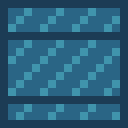
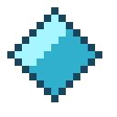
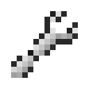
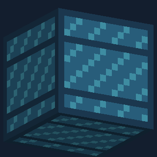
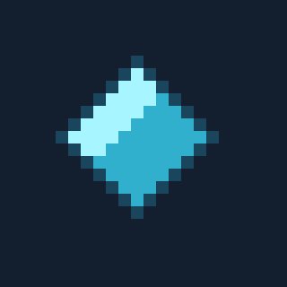
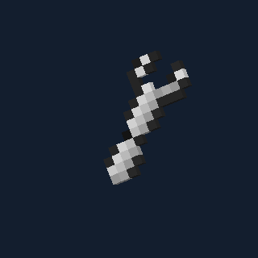

# テクスチャ一覧

アイテム・ブロック・UI を追加／変更するたびに、この一覧と PNG 見本を更新します。

**画像は JSON から生成した簡易見本で、ゲーム内スクリーンショットではありません。**
手持ち画像は一人称右手の `display` 設定を適用したモデル単体の見本です（プレイヤーの手は描画しません）。
ブロック画像は設置形状の見本です。陰影・透過・照明・カメラは Minecraft と完全には一致しません。
サイトの公開とは独立して更新します。

## テクスチャ

| ID | 区分 | PNG（拡大） | 元画像 |
|---|---|---|---|
| `starblazercraft:block/example_block_side` | 説明用・未登録 |  | [16×16](docs/examples/assets/starblazercraft/textures/block/example_block_side.png) |
| `starblazercraft:block/example_block_top` | 説明用・未登録 |  | [16×16](docs/examples/assets/starblazercraft/textures/block/example_block_top.png) |
| `starblazercraft:item/example_crystal` | 説明用・未登録 |  | [16×16](docs/examples/assets/starblazercraft/textures/item/example_crystal.png) |
| `starblazercraft:item/wrench` | 実装素材 |  | [16×16](src/main/resources/assets/starblazercraft/textures/item/wrench.png) |

## 3D・手持ち見本

| モデル | 種別 | PNG 見本 | JSON |
|---|---|---|---|
| `starblazercraft:block/example_block` | 設置時（説明用・未登録） |  | [JSON](docs/examples/assets/starblazercraft/models/block/example_block.json) |
| `starblazercraft:item/example_block` | 手持ち（説明用・未登録） |  | [JSON](docs/examples/assets/starblazercraft/models/item/example_block.json) |
| `starblazercraft:item/example_crystal` | 手持ち（説明用・未登録） |  | [JSON](docs/examples/assets/starblazercraft/models/item/example_crystal.json) |
| `starblazercraft:item/wrench` | 手持ち |  | [JSON](src/main/resources/assets/starblazercraft/models/item/wrench.json) |

## レンチの参考画像

[IMG_0185.png](画像/IMG_0185.png) をもとに、銀色の本体・黒い輪郭・斜めの持ち手を再現しています。
参考画像のサイズは自由です。本番は16×16、手持ちモデルは輪郭に沿って厚みを付けています。

## UI

現在、独自 UI は未実装です。UI 追加時はテクスチャと画面全体の PNG 見本・用途をここに追記してください。

## 更新方法

```sh
python3 -m pip install -r requirements-dev.txt
python3 scripts/generate_texture_index.py
python3 scripts/generate_texture_index.py --check
```

一覧とモデル見本は自動生成です。説明の変更は `scripts/generate_texture_index.py` に反映してください。
未対応モデルは生成エラーにして、誤った見本を黙って掲載しない方針です。
UI の画面全体の見本・用途は追加時に生成処理も拡張します。
